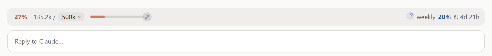

# Claude Code Cockpit

A mod for [Claude Code](https://claude.com/claude-code): one line above the prompt that tells you how full this session's context is, what it is costing, and when it will compact, with auto-compact's window and a compact button on the line itself.

Unofficial. Not affiliated with Anthropic.

## What you get

### `context-card`: one line above the prompt

<picture>
  <source media="(prefers-color-scheme: dark)" srcset="docs/card-dark.png">
  
</picture>

| On the line | Meaning |
| --- | --- |
| `27%` | How full the context is, measured as `/context` measures it: against the auto-compact window when auto-compact is on. Turns amber at 60%, red at 80%. |
| `159.5k /` `500k ▾` | Tokens used, of the auto-compact window. The window is a dropdown: `400k` `500k` `600k` `Auto` (saved for the model as `/autocompact` saves it) or `Off`. When the window in force is not the one picked (Auto, Off, or one the engine raised for a long conversation), its number is written out too. |
| The bar and its knob | The same percentage, with a compact button at its end. Below 60% the first click turns the knob into a check for three seconds and a second click compacts; from 60% one click compacts. It shows a half disc while any compaction runs. |
| `◎` `weekly 20% ↻ 4d 21h` | Your plan's weekly usage and when it resets, read live from your account. The double ring sets the plan used (outer) against how much of the week has gone (inner). |

Every control runs the official `/config` row or slash command. The prompt-cache mark is gone: Claude Code now compacts an idle session before its cache expires.

## Install

From this repository:

```
/plugin marketplace add Nongfsq/frank-claude-cockpit
/plugin install context-card@frank-claude-cockpit
```

Or copy the folder into `~/.claude/skills/` and start a new session:

```bash
git clone https://github.com/Nongfsq/frank-claude-cockpit
cp -R frank-claude-cockpit/context-card ~/.claude/skills/
```

The sessions pane, `pr-pane`, is retired: Claude Code's own `/ship` now opens, reviews and watches pull requests. Its last version is in this repository's history.

## Requirements

- **A recent Claude Code.** The mod uses the hooks-module API (`ui.render`, `$.state`); it is tested on 2.1.330.
- **`context-card`'s weekly usage** needs a Claude subscription login. With an API key the card still shows context, without the weekly figure.

## What leaves your machine

- `context-card` asks `api.anthropic.com` for your own plan usage with the login Claude Code already holds, at most once every two minutes however many sessions are open: one session asks and the rest read its answer from `~/.claude/cache/context-card-usage.json`. That request uses no tokens.
- **The compact knob** compacts the conversation as `/compact` does, which costs what a compaction costs.

Nothing else is sent anywhere.

## Development

```bash
claude plugin validate context-card
claude plugin test context-card
```

Types for an editor: run `/plugin-types` inside a mod's folder.

The card's screenshots and demo come from a scripted page, [`docs/demo/index.html`](docs/demo/index.html), recorded with [`docs/demo/record.mjs`](docs/demo/record.mjs). It still shows the retired sessions pane and is rebuilt with the card's redesign.

## Support

If this project is useful to you, you can buy me a coffee.

<a href="https://buymeacoffee.com/frankmenger"></a>

## License

[MIT](LICENSE)
